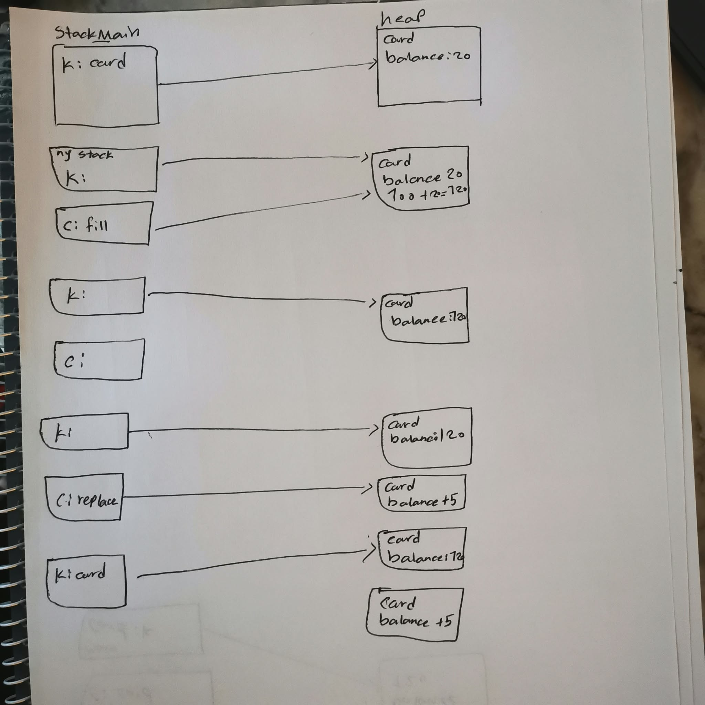
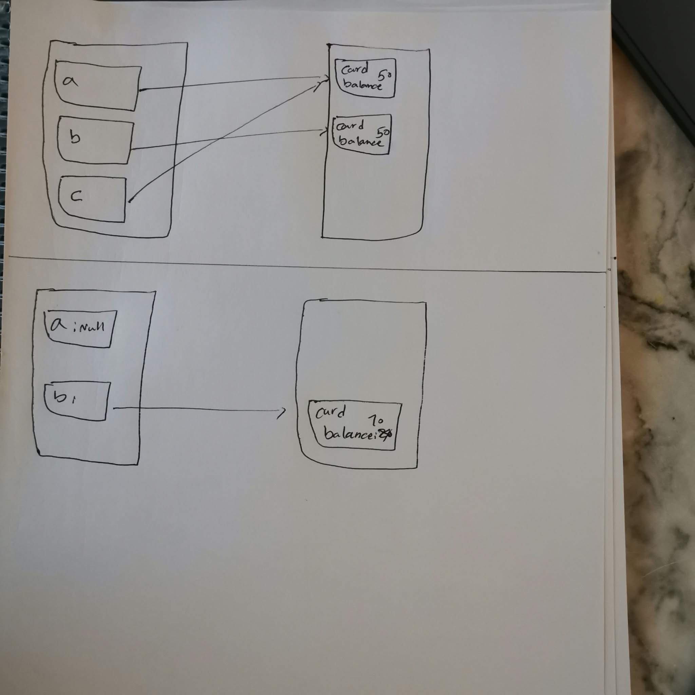

# Del B: Referenser på papper

Lägg foton eller en skanning av dina minnesbilder i mappen `answers/part-b/`.

| Program | Min förutsägelse | Faktisk utskrift | Förklaring om de skiljer sig |
|---|---|---|---|
| B1 |80,80 |80, 80 |  card a och b pekar på samma card object new card(50) det innebär att både har saldo 50 sedan b.add(30) tilllägger 30+ på saldot och 50 + 30 = 80. sedan finns två output som skriver ut beloppet. |
| B2 |120 | 120| card k har saldot 20 och + fill(k) 100 add = 120. det main objektet är k och c är bara en lokal referens  |
| B3 |true , false, true | false , true , true| tänkte att a är lika med b eftersom både hade värde 50 men i java operaron == jämför referenser när det gäller objekt och inte själva innehållet så min förutsägelse var fel. C pekar ochså på samma object som a och är true. a och b getBalance då jämför numeriska värden. |
| B4 | null,  10 | true, 10 , exeption error| både a och b pekar på samma object med balance 10 men efterson b är == null så skriver ut True.   |

